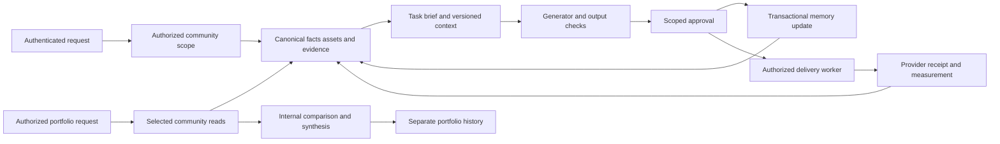

# oneClick community brain implementation plan

October 13, 2026. Execution owner: Codex. Status: implementation in progress following the user's instruction to implement the whole plan. Live production rollout and external provider qualification are tracked separately from local implementation in the [execution evidence ledger](/Users/jasjitgill/oneClick/docs/COMMUNITY_BRAIN_IMPLEMENTATION_STATUS_2026_10_13.md).

Build a dependable knowledge and execution foundation for hundreds of real estate communities. Each community owns its facts, evidence, assets, brand, approved creative and measurements. Product generators receive only eligible community context. An explicitly authorized internal assistant can find assets and compare selected communities while keeping its combined history separate from community knowledge.

The stack remains Supabase Postgres, pgvector and Storage, the existing web application, and durable backend workers. Start with exact scoped vector search and structured queries. Introduce independent community approximate indexes, dedicated infrastructure or additional providers when the defined security or workload requirements justify them.

## Baseline and governing evidence

- [Community brain architecture review](/Users/jasjitgill/oneClick/docs/COMMUNITY_BRAIN_ARCHITECTURE_REVIEW_2026_10_13.md), including the final sanity check, is the finding and decision baseline.
- [Platform and ingestion review](/Users/jasjitgill/oneClick/docs/REAL_ESTATE_MARKETING_PLATFORM_AND_INGESTION_REVIEW_2026_10_13.md) supplies the product and format coverage baseline.
- [Audit evidence](/Users/jasjitgill/oneClick/docs/COMMUNITY_BRAIN_AUDIT_EVIDENCE_2026_10_13.json) retains live catalog/results, reproducible defects, test results and file fingerprints. This local JSON is ignored by the repository; retain a sanitized, versioned release manifest when implementation begins.
- [Existing platform completion ledger](/Users/jasjitgill/oneClick/docs/P11_PLAN_COMPLETION.md), [action and learning plan](/Users/jasjitgill/oneClick/docs/P11_ACTION_LEARNING_PLAN.md), and [Phase 7 local completion](/Users/jasjitgill/oneClick/docs/PHASE_7_LOCAL_COMPLETION.md) identify foundations to reuse. Their historical release bundles and completion counts must be reconciled against today's catalog and code before reuse.

The inspected application baseline is commit `b07cdc170ff40b5d85baf0164a77b302777f062f` plus 14 uncommitted application/test files. Their hashes still matched the audit when this plan was prepared. Preserve the reporting, client portal and intelligence changes; build on them without resetting, stashing away, or silently committing unrelated work.

The live source of truth is Supabase project `lmjmutuggvzuadwreqxx`. The audit found 9 communities, 132 general document rows, 439 competitor chunks and 14 library assets. The final ownership checks found no mismatch in the examined one floorplan link, 81 website asset links and 1,659 job/context links. These are baseline observations, not an authorization certification. Read-only planning checks also confirmed the existing client assignment table, organization/profile roles, knowledge version tables and leased shared jobs. Most newer workflows remain unpopulated.

## Decisions to carry into implementation

1. **Community ownership is mandatory.** Every ordinary request, source, job, context, selected asset, output and writeback destination must have the same authorized owner. Competitors are separate described entities within the owner's research. Missing or contradictory ownership blocks the operation.
2. **Authorization has two layers.** Membership/capabilities establish what an actor may access; a server-bound task scope establishes what this particular operation may use. An employee authorized for A and B still receives only A's evidence when generating for A.
3. **Canonical records remain authoritative.** Use structured inventory, brand contracts and measurement tables for exact facts; use retained evidence and derived search indexes for discovery. Do not build a competing universal JSON truth store.
4. **A service package and a context bundle have different jobs.** The service package describes goals, deliverables, channels, timing and limits. Each generation task receives a specific brief plus a versioned, authorized selection of facts, evidence and exact assets.
5. **Approval updates the appropriate memory.** Accepted facts, approved creative, permission to publish and permission to spend are separate decisions. Approval automatically queues the relevant memory update; generated language cannot manufacture factual authority.
6. **Files retain identity.** Store originals and selected renditions with ownership, hashes and versions. Floorplans and logos use exact references. Similarity search never substitutes another drawing or establishes a property amenity.
7. **The internal assistant has its own scope and history.** Permit selected-community reads and deterministic comparisons. Deny implicit community writeback, arbitrary SQL, uncontrolled external requests and reuse of its combined conversation in community generation.
8. **Existing execution foundations come first.** Extend shared jobs, native product workers, approvals, receipts and compensation. Do not activate the disposable Agency executor by removing its database-name guard.
9. **Use an additive migration and per-community rollout.** Keep valid history and published assets available during migration; quarantine ambiguous evidence. An unsafe legacy fallback is not a rollback strategy.
10. **Treat model providers as retained-data systems.** Scope provider files, responses and containers, minimize payloads, record retention and reconcile cleanup. The selected model is replaceable; a separate trained model per community is unnecessary.

The target shared deployment must protect against unauthorized users, incorrectly scoped application calls, model/tool manipulation, wrong joins, cache/session reuse and worker mistakes through enforced, tested boundaries. A compromised project administrator or broadly privileged infrastructure credential has a different reach. CB02 records the containment requirement and credential topology; if a community requires containment from such a compromise, route its facts, vectors and private assets to a separately credentialed environment before its rollout. A separate vector table alone does not satisfy that requirement.

## Execution order and completion ledger

Each package should become one or more focused, reviewable changes. Keep the package ID in implementation notes and qualification evidence. Local development can proceed where dependencies are ready; a release must meet all of its gates. No estimated calendar duration is asserted before the environment and migration baseline are qualified.

| Package | Deliverable | Dependencies | Status |
| --- | --- | --- | --- |
| CB00 | Baseline, isolated test environment and migration inventory | None | Local baseline and release evidence recorded |
| CB01 | Confirmed floorplan and legacy import defects repaired | CB00 | Implemented locally; staged acceptance open |
| CB02 | Actor capabilities and immutable task scopes | CB00 | Implemented locally; staged acceptance open |
| CB03 | Database, RPC, storage and relationship enforcement | CB02 | Implemented locally; staged acceptance open |
| CB04 | Canonical asset identity, private originals and reliable transfer | CB01, CB03 | Implemented locally; staged acceptance open |
| CB05 | Canonical evidence contracts and legacy reconciliation | CB03 | Implemented locally; staged acceptance open |
| CB06 | Durable common intake and core document/image/floorplan processing | CB04, CB05 | Implemented locally; staged acceptance open |
| CB07 | Remaining file formats and source adapters | CB06 | Processors/adapters implemented; format qualification open |
| CB08 | Eligible hybrid retrieval and shared product context | CB05, CB06 | Implemented locally; staged acceptance open |
| CB09 | Automatic approved feedback and continuous source maintenance | CB05, CB06, CB08 | Implemented locally; staged acceptance open |
| CB10 | Fresh account-scoped measurement and delivery evidence | CB01, CB03, CB05 | Implemented locally; staged acceptance open |
| CB11 | Provider state controls and generated-output fidelity | CB04, CB05, CB08 | Core guards implemented; provider coverage open |
| CB12 | Internal portfolio assistant | CB03, CB04, CB08, CB10, CB11 | Implemented locally; staged acceptance open |
| CB13 | Initiative and service-package coordination | CB08, CB09, CB10, CB11 | Coordination implemented; attribution/cost qualification open |
| CB14 | Complete supervised community marketing pilot | CB07 core qualification, CB09, CB12, CB13 | Open — real pilot not selected/run |
| CB15 | Additional channel and provider qualification | CB10, CB13, CB14 | Open — per-channel implementation and qualification |
| CB16 | Measured recommendations and bounded autonomy | CB14 and each participating CB15 adapter | Open — measured learning and bounded actions |
| CB17 | Capacity, retention, recovery and operational acceptance | Begins with CB00; final acceptance after participating packages | Local operations/load/restore checks; remaining gates open |

First execution sequence: **CB00 → CB01 → CB02 → CB03**. Then complete CB04–CB06 and build CB08–CB11 on those contracts while adding CB07 formats in qualified increments. Deliver CB12's exact floorplan retrieval and campaign comparisons before broad strategy synthesis; it need not wait for unrelated file/provider extensions. The complete supervised pilot requires CB07's core lanes. CB13–CB16 extend this foundation into managed campaigns and qualified automation. CB17 tests and instrumentation accompany every increment.

## Contracts and implementation locations

The following interfaces are proposed implementation contracts, not existing APIs. Put the shared server-side coordination in a new `utils/community-brain/` module under the web application, with a versioned wire contract for Python workers. Keep native domain writers in their current modules. Do not create a second implementation of authorization or measurement calculations in Python.

| Contract | Required behavior |
| --- | --- |
| `resolveCommunityScope(session, propertyId, purpose)` | Derive actor and current permissions from trusted authentication and saved grants. Return an immutable scope identifier, organization/community, audience, allowed capabilities, policy revision and permission revision. Browser/model input cannot supply authority. |
| `resolvePortfolioScope(session, requestedCommunities, operation)` | Resolve permitted selection, preserve organization/community pairs, produce explicit coverage. No default global scope. Existing organization membership alone does not confer a platform-wide portfolio role. Cross-organization access requires explicit delegation if that capability is introduced. |
| `SourceRef` | Discriminated source kind plus existing identity/version: material version, web capture, competitor capture, inventory version, brand revision, approved creative or measurement receipt. Include owner, described entity, authority, visibility, allowed uses, effective interval, review deadline and original evidence reference. |
| `AssetRef` | Owner, stable asset/version ID, original bucket/key/hash, selected rendition/page, role, depicted entity, real/generated status, approval, rights and expiry. Do not use a temporary URL as identity. |
| `getCommunityContext(scope, task)` | Exact facts and required brand/assets first; eligible lexical/vector evidence second; optional measurements by purpose. Return a manifest, omissions/conflicts and bounded model-facing content. |
| `GenerationContext` | Scope, task/service-package reference, immutable source and asset versions, read-set revision/hash, policy and retrieval recipe, prompt/model versions, expiry rules and sensitivity. Context scope must equal job scope. |
| `readPortfolioEvidence(scope, request)` | Typed exact asset or measurement retrieval, per-community coverage and dates; bounded fan-out and pagination. Returned results retain community identity through synthesis. |
| `recordApprovalAndEvent(scope, version, decision)` | Validate current source eligibility and decision authority; atomically persist the exact approval plus a durable update event. Publication/spend authority remains separate. |
| `ProviderObjectRef` | Community/job or portfolio scope, provider/project, object kind/ID, parent objects, data-policy revision, expiry, deletion/reconciliation state. No unrestricted provider handle supplied by a model. |
| `MeasurementReceipt` | Verified account/community mapping, provider/report definition, time window/timezone, currency, pagination/watermark, counts and completeness state. Reading all saved rows is distinct from receiving a complete provider report. |

Source references with different table kinds must resolve through typed adapters and database validation. A polymorphic UUID in JSON is insufficient referential integrity. Prefer typed foreign keys; where a manifest legitimately references several kinds, verify kind, owner, existence and exact version through a single supported resolver.

### Reuse and schema boundaries

| Responsibility | Existing base | Planned extension |
| --- | --- | --- |
| Access | `profiles`, team functions, `client_portal_accounts`, `client_portal_property_access` | Reuse account status and client assignments. Add explicit staff/community capability grants and revisions where absent; do not derive privileges from user-editable metadata. |
| Inventory and facts | `properties`, `property_units`, `property_intelligence_documents` | Reviewed typed facts and version references; consistent floorplan asset/page binding and validity. |
| Source lifecycle | `knowledge_sources`, `knowledge_files`, `knowledge_file_extractions`, `knowledge_materials`, `knowledge_material_versions`, web captures/policies | Owner/subject/purpose/authority normalization, immutable original and extraction lineage, recurring-check state. |
| Competitive evidence | Competitors, captures, `competitor_content_chunks` | Capture-linked eligible versions, explicit competitor subject, reconciliation of unlinked history. |
| Assets and brand | `content_assets`, `website_assets`, approved brand contracts | Version/rendition references, private originals, precise approval/rights projection and ownership constraints. |
| Search | `documents`, `competitor_content_chunks`, existing embedding requests | Compatible, versioned text representations and full-text projection. Separate visual embeddings when justified. |
| Context and dependencies | `shared_context_snapshots`, generation source manifests | Common manifest contract, typed dependency records, explicit scope kind and publication eligibility checks. |
| Jobs and approval | `shared_jobs`, action attempts/events/episodes, approvals, policy decisions, execution budgets | Register ingestion/index/update job types and transactional dispatch. Processing budgets remain separate from media-spend authorization. |
| Measurements | Marketing fact table, BI/intelligence reporting, native delivery/outcome records | Feed completeness receipts, source-aware shared calculations and initiative/creative attribution links. |
| Portfolio history | No working master assistant established | New private session/message/evidence membership records with current access checks and no community-publication path. |

Preserve domain history where a row currently contains only the latest state; add the smallest version/audit relationship needed to make a manifest reproducible. Physical new-table names are selected after CB00's live/local reconciliation. Do not duplicate an installed lifecycle because its new tables currently contain zero rows.

## Work packages

### CB00 Establish the implementation baseline

**Work**

- Record current HEAD, dirty-file hashes, deployed web/data-engine versions where observable, live migration history, function hashes, policies/grants, storage settings and active scheduler inventory. Separate candidate code from deployed behavior.
- Reconcile this plan with older frozen release bundles. Generate a current delta from the actual database; do not replay all local migrations or rewrite remote migration history to make them agree.
- Prepare a disposable local database and staging target with synthetic communities A/B in one organization and C in another. Include an A-only employee, an authorized A/B portfolio employee, a client, an unauthenticated widget and constrained workers. Preserve the existing developer database.
- Capture baseline evidence for the two reproduced code defects and the live video bucket mismatch. Promote the useful isolated reproductions into permanent regression tests during CB01/CB04.
- Inspect current runtime/database compatibility and advisory findings. The audited server was PostgreSQL 17.6; Supabase has announced a 17.11 rollout with compatibility checks. Rehearse any required patch/extension work separately from feature migrations, including actual `pgcrypto` usage; its installation alone does not show affected encryption. [Supabase upgrade notice](https://supabase.com/changelog/postgres-15-19-17-11-breaking-changes).
- Create a sanitized implementation evidence ledger with package status, schema/type hashes, test commands/results, migration/backfill manifests, rollback evidence and unresolved external dependencies.

**Locations:** [Supabase configuration](/Users/jasjitgill/oneClick/p11-platform/supabase/config.toml), [schema checks](/Users/jasjitgill/oneClick/p11-platform/apps/web/scripts/check-schema-truth.mjs), [completion ledger](/Users/jasjitgill/oneClick/docs/P11_PLAN_COMPLETION.md).

**Done when:** the starting code/data state is reproducible, legitimate and denied fixture access is explicit, and the implementation can run without changing production or resetting user work.

### CB01 Repair the reproduced defects

**Work**

- Fix floorplan association so a valid explicit asset ID takes precedence everywhere. Use legacy URL matching only when there is no ID; reject ambiguous matches and wrong role/property. Apply the same resolver to package manifests, previews and future portfolio downloads.
- Preserve shared drawings intentionally linked to multiple plan records, while rejecting unintended multiple drawings for a single canonical plan. Do not guess missing live links from filenames.
- Make legacy import functions return typed outcomes and counts or propagate failures. A caught fetch/database failure cannot become `success`; distinguish valid empty reports from skipped/unconfigured work.
- Fail closed when Google account lookup fails. Any retained environment-based single-account mode must be explicitly configured, validate its property/account binding and never activate as an error fallback.
- Identify legacy runner callers and replace them with the tracked import path where appropriate. Preserve the disabled untracked bulk endpoint and the account-aware fact uniqueness key.

**Locations:** [package source](/Users/jasjitgill/oneClick/p11-platform/apps/web/utils/siteforge/packages/source.ts), [source tests](/Users/jasjitgill/oneClick/p11-platform/apps/web/utils/siteforge/packages/source.test.ts), [legacy runner](/Users/jasjitgill/oneClick/p11-platform/services/data-engine/run_pipelines.py), [Google pipeline](/Users/jasjitgill/oneClick/p11-platform/services/data-engine/pipelines/google_ads.py), [tracked importer](/Users/jasjitgill/oneClick/p11-platform/services/data-engine/pipelines/mcp_marketing_sync.py).

**Done when:** the conflicting-ID/URL reproduction returns only the authoritative drawing; import failure/empty/success cases are distinguishable; no failed lookup changes ownership or dispatches an alternate account.

### CB02 Define and enforce request capabilities

**Work**

- Implement the scope resolvers and capabilities for community knowledge, asset preview/download, measurements, generation, source review, fact approval, creative approval, publication and spending. Portfolio read permission grants none of the mutation capabilities.
- Extend existing team/client access with explicit community assignments and deliberate all-portfolio grants. Retain current account blocked/deleted checks and support permission revisions for revocation.
- Replace organization-only use of `validatePropertyAccess` on brain-dependent paths with the new resolver. Inventory every caller and migrate remaining paths deliberately; do not silently change a shared helper's meaning while leaving callers untested.
- Bind public chat to the saved widget/session community and public audience. Neither a model tool argument nor switching a request parameter may retarget an existing conversation.
- Design constrained worker access: a trusted dispatcher binds a claimed job to a community, operation, source revision, expiry and lease. Workers use a narrow database role/operation surface and cannot exchange an arbitrary actor ID for another user's authority. Validate binding at claim, read and commit.
- Record the deployment threat model and routing decision. Keep models and extraction sandboxes free of general service credentials. If dedicated community environments are required, implement routing and test the same contract across two environments before rollout; do not provision hundreds speculatively.

**Locations:** [auth guard](/Users/jasjitgill/oneClick/p11-platform/apps/web/utils/services/auth-guard.ts), [team store](/Users/jasjitgill/oneClick/p11-platform/apps/web/utils/team/store.ts), [client access](/Users/jasjitgill/oneClick/p11-platform/apps/web/utils/client-portal/server.ts), [chat scope](/Users/jasjitgill/oneClick/p11-platform/apps/web/utils/chat-scope.ts). New scope module and tests live under `utils/community-brain/`.

**Done when:** A-only staff cannot resolve B; authorized A/B staff can intentionally create a portfolio scope but an A generation remains A-only; forged actor/scope/capability inputs and stale permissions fail closed.

### CB03 Enforce ownership at database and storage boundaries

**Work**

- Inventory direct table/API access, RPC execution grants, views, Realtime publications and Storage policies. Replace permissive organization-wide access on affected knowledge/media paths with operation-specific community authorization; check policy combinations, not just newly added policies.
- Require scope in both general and competitor search. Remove the nullable broad competitor search from ordinary consumers; provide a separate explicitly authorized portfolio operation if needed. Preserve restricted execution grants rather than exposing the existing document definer function.
- Add composite owner relationships, or equivalent database validation, for floorplan asset/page links, website source assets, source/duplicate/replacement assets, source versions/chunks, generation dependencies, jobs and contexts. Add supporting unique/filter indexes and validate existing rows before enforcing constraints.
- Retain existing floorplan import, governance, replacement and domain-specific job guards. Test every insert/update writer, including service paths. RLS alone does not constrain a bypass role; separate worker permissions and validated operations are part of this package. [Supabase RLS](https://supabase.com/docs/guides/database/postgres/row-level-security).
- Preserve explicitly organization-scoped administrative jobs. An old `property_id = NULL`, including a value cleared on deletion, must never imply global knowledge visibility. Classify legacy scope; retain owner tombstones or restrict deletion where needed to keep history private.
- Give views appropriate invoker semantics or restrict their grants; fix search paths and revoke unnecessary default function execution. Review the specific advisor findings without treating every service-only no-policy table as exposure.

**Locations:** [database tests](/Users/jasjitgill/oneClick/p11-platform/supabase/tests/phase_zero_access.test.sql), [client access tests](/Users/jasjitgill/oneClick/p11-platform/supabase/tests/client_portal_access.test.sql), [knowledge material tests](/Users/jasjitgill/oneClick/p11-platform/supabase/tests/knowledge_materials.test.sql), [foundation guard checks](/Users/jasjitgill/oneClick/p11-platform/apps/web/scripts/check-foundation-trust-boundaries.mjs), plus new migrations and community-isolation SQL suites.

**Done when:** real-role database/API tests deny unauthorized reads and writes, allow intended staff/client operations, and reject wrong-owner references even through privileged application writers. No new shared-context release precedes this gate.

### CB04 Standardize files and asset identity

**Work**

- Use private canonical originals with immutable versioned keys; expose only deliberate approved public renditions. Define one asset storage policy shared by UI, server validation, bucket configuration, recovery and consumers. Repair the MP4/WebM destination/100 MiB versus 50 MiB mismatch against real staging Storage.
- Implement scoped direct/resumable uploads and a finalize operation that verifies object existence, byte count, detected type and hash. Bind destination to the saved upload intent. Recheck ownership before linking the result; expire orphaned uploads safely.
- Add rendition/page records and task selection. Packaging should receive chosen approved images and compatible derivatives within its byte budget, while preserving original hashes and relationships. A permitted upload must not unexpectedly block a build because every library original was included.
- Carry image-asset and PDF-page binding through reviewed unit contracts, guided import, manual editing and generators. Preserve the valid live unit and website source links; reconcile missing links explicitly.
- Retain brand source originals and source-to-logo/font/contract lineage. Normalize the separate approval/curation/rights fields into an eligibility decision without silently upgrading old approvals.
- Implement authenticated private preview/download/bundle delivery with current permissions on each request and no public cache. Keep existing public URLs working until a classified rendition migration is ready. Document outstanding signed-link and in-flight limits; signed links alone cannot promise immediate revocation. [Supabase downloads](https://supabase.com/docs/guides/storage/serving/downloads), [CDN behavior](https://supabase.com/docs/guides/storage/cdn/smart-cdn).

**Locations:** [asset service](/Users/jasjitgill/oneClick/p11-platform/apps/web/utils/storage/asset-service.ts), [library upload](/Users/jasjitgill/oneClick/p11-platform/apps/web/utils/forgestudio/asset-library-store.ts), [SiteForge upload](/Users/jasjitgill/oneClick/p11-platform/apps/web/app/api/siteforge/assets/route.ts), [unit contracts](/Users/jasjitgill/oneClick/p11-platform/apps/web/utils/property-units/contracts.ts), [brand source import](/Users/jasjitgill/oneClick/p11-platform/apps/web/app/api/brandforge/import/sources/route.ts).

**Done when:** upload/finalize/retry, exact plan preview, private download/revocation and selected-file generation work against staging Storage; mismatched types, owners, hashes and stale approvals fail safely.

### CB05 Normalize truth and reconcile legacy evidence

**Work**

- Implement the owner-versus-subject, authority, audience, permitted-use, effective-time and review-deadline contracts. Keep a competitor amenity in competitor research; never let it satisfy a community amenity fact.
- Adapt existing inventory, brand, materials, web/competitor captures and intelligence documents to `SourceRef`. Use existing `knowledge_source_id`, `knowledge_material_id`, `version_id` and `capture_id` relationships. Add version history where exact replay currently cannot be supported.
- Create a deterministic dry-run reconciliation report for the 132 general documents and 439 competitor chunks, including missing embeddings, capture links, metadata, stale summaries and missing source ownership. Classify each as linked/eligible, archived history, needs review, or unresolved; retain original content and decisions.
- Reconcile the 312 capture-unlinked competitor chunks, inactive competitors and newer captures. Never assign provenance by similarity alone. Preserve valid existing embeddings only when their model/recipe compatibility is established; otherwise regenerate eligible representations into a versioned projection.
- Resolve contradictory current facts through the existing review process. Track proposed extraction separately from accepted fact. Keep prices, availability, currency, dimensions and room counts typed and freshness-bound.
- Move fields used for eligibility out of unvalidated arbitrary JSON into constrained columns or validated indexed projections. Context assembly should never infer public/approved status simply because a legacy row exists.

**Locations:** [material store](/Users/jasjitgill/oneClick/p11-platform/apps/web/utils/knowledge/material-store.ts), [material model](/Users/jasjitgill/oneClick/p11-platform/apps/web/utils/knowledge/material-model.ts), [canonical intelligence](/Users/jasjitgill/oneClick/p11-platform/apps/web/utils/intelligence/store.ts), [fact contracts](/Users/jasjitgill/oneClick/p11-platform/apps/web/utils/knowledge/fact-contracts.ts), and the live search/source tables.

**Done when:** every eligible evidence row resolves to a permitted owner, subject and version; unresolved rows remain visible to operators and unavailable to generators; backfill replay changes neither counts nor decisions unexpectedly.

### CB06 Build common intake and core processors

**Work**

- Extend the existing jobs/claims/receipts into one intake lifecycle: saved intent → verified original → extracted candidate → review/linking → eligible publication → search readiness. Model these as separate states; “stored” does not mean “ready for generation.”
- Add processor registry entries with supported type, detected MIME, limits, processor/version, output schema, resource envelope and retention policy. Use existing simple text/PDF extraction where suitable; retain the lossless original extraction separately from retrieval chunks.
- Add PDF page rendering, OCR and layout extraction for scanned and mixed documents. Retain page coordinates, confidence and extraction versions. Evaluate representative floorplans/brochures before selecting the production OCR provider; the adapter must not depend on one vendor's response format.
- Process community images into safe renditions, captions, tags and optional OCR. Review or label uncertain visual assertions. Process PDF/image floorplans into exact drawing/page links and proposed specifications; dimensions and room counts require supported evidence and review.
- Run heavy processing in bounded workers using the existing data engine as the starting point. Isolate parsers; disable document macros/active content and unintended network access; bound pages, pixels, archive expansion, time and memory. Detect encrypted/corrupt files and return actionable outcomes.
- Use source-version/processor-recipe idempotency, expiring leases, retry/backoff, cancellation and terminal error states. Reconcile uncertain provider submissions before paying again. Failed processing cannot publish partial replacements or restore withdrawn data.

**Locations:** [file store](/Users/jasjitgill/oneClick/p11-platform/apps/web/utils/knowledge/file-store.ts), [extraction](/Users/jasjitgill/oneClick/p11-platform/apps/web/utils/knowledge/file-extraction.ts), [image analysis](/Users/jasjitgill/oneClick/p11-platform/apps/web/utils/siteforge/assets/image-analysis.ts), [data-engine service configuration](/Users/jasjitgill/oneClick/p11-platform/services/data-engine/render.yaml).

**Done when:** text, image and scanned/mixed PDF inputs preserve originals, expose extraction quality, accept reviewed facts, retain exact plan drawings and become available to all intended consumers through the shared contract.

### CB07 Complete the format and source coverage contract

Implement the following supported lanes in increments; each needs real fixtures and clear unsupported/partial states. An adapter is complete only when its full intake-to-consumer path passes. CB14 requires every core lane below. Additional connectors can join after individual qualification without blocking the core pilot.

| Lane | Processing and identity requirements | Release scope |
| --- | --- | --- |
| TXT and Markdown | Encoding validation, retained original, section-aware text and citations | Core |
| Text, scanned and mixed PDFs | Retain original, page previews, text/OCR/layout evidence and reviewed extraction | Core |
| JPEG, PNG, WebP and GIF | Metadata, orientation, hash, renditions, captions; preserve or explicitly explain animation handling | Core |
| Floorplan images and multi-plan PDFs | Split/link reviewed pages by plan ID; exact drawings and typed specifications; never fabricate geometry | Core |
| SVG logos and supported font formats | Validate/sanitize active content, retain original plus safe rendition, exact brand role and license/usage metadata | Core |
| CSV and XLSX | Typed previews, sheet/table selection, units, dates, null/zero handling and source/account/outcome IDs; formulas are not executed as code | Core |
| DOCX and PPTX | Extract text, tables, page/slide references and embedded asset relationships; preserve original and review lossy conversion | Core |
| MP4 and WebM | Retained original, metadata, poster/proxy renditions, selected frames/transcript where applicable; separate video delivery and processing budgets | Core upload/retrieval; generation consumption qualified per product |
| Public community and competitor sites | Scoped static/rendered capture, relevant linked files, redirects and safe fetch rules, canonical URLs, capture versions and deletion/change detection | Core |
| Drive and Dropbox | Existing image adapters first; then supported document/video imports and native document exports with stable provider ID/revision, credentials, moves/deletions and reconnect handling | Qualified connector increments |
| Inventory, CRM, ads, analytics and review feeds | Typed source adapters, verified account/community bindings, pagination, effective dates and completeness receipts | Required for the selected pilot; expand by provider |
| External virtual tours and embeds | Approved provider reference, offering link and safe embed policy; keep a reference distinct from an owned file | Core reference handling |
| ZIP, legacy Office, CAD/BIM, 3D and additional media | Detect and explain unsupported inputs. Add a separately qualified parser/conversion lane only when a product needs it; preserve supplied originals where intake policy permits | Explicit extension backlog, never silently advertised as supported |

Drive/Dropbox connection success must not imply all provider file types work. Extraction failures remain distinct from empty files. Show progress and required review in the community UI, and provide one asset/floorplan lookup surface rather than separate incompatible product libraries.

**Locations:** [source adapters](/Users/jasjitgill/oneClick/p11-platform/apps/web/utils/siteforge/assets/source-adapters.ts), [source ingestion](/Users/jasjitgill/oneClick/p11-platform/apps/web/utils/siteforge/assets/source-ingestion.ts), [floorplan adapters](/Users/jasjitgill/oneClick/p11-platform/apps/web/utils/siteforge/providers/floor-plans.ts), [intelligence CSV import](/Users/jasjitgill/oneClick/p11-platform/apps/web/utils/intelligence/import.ts), and the common processor registry introduced by CB06.

**Done when:** each advertised format has a retained original, useful extraction or exact retrieval, reviewed entity links, a downstream consumer test and a stated limit. No upload acceptance hides a later unsupported handoff.

### CB08 Deliver eligible retrieval and shared generation context

**Work**

- Implement one eligibility resolver shared by exact queries, full-text search, vectors, caches and fallback paths. Filter owner, subject, audience, purpose, approval, active version and validity before evidence enters model context. Empty retrieval never widens scope.
- Add indexed structured filters and Postgres full-text search, then combine bounded lexical/vector rankings and deduplicate source versions. Start with exact community-scoped vector distance; benchmark against existing competitor IVFFlat. Do not label native full-text ranking BM25.
- Preserve compatible embedding namespaces by model, dimensions, modality and recipe. Keep 512-dimensional asset representations separate from 1,536-dimensional text representations; equal dimensions alone do not prove compatibility. Embed eligible captions first; defer visual similarity to measured need.
- Build context manifests with exact inventory, approved brand and task-selected assets, then relevant evidence and permitted metrics. Bind current public answers to server time; allow historical `asOf` requests only for an authorized historical purpose. Read under a consistent database snapshot where practical; otherwise validate the read-set revisions and retry boundedly. Several independent concurrent queries are not automatically one snapshot.
- Migrate consumers: Luma compact profile plus exact tools/retrieval per turn; SiteForge package and portable Codex brief; ForgeStudio context; BrandForge source retrieval; market/agency briefs. Fix snapshot paths that ignore chatbot eligibility and legacy context that labels every document public/curated.
- Version scope/policy/source-aware caches. Recheck permissions and volatile facts before use. If vector preparation fails, use eligible exact/lexical evidence or explain the gap; do not restore superseded or withdrawn facts. Retain the currently eligible source when replacement processing fails.

**Locations:** [chat route](/Users/jasjitgill/oneClick/p11-platform/apps/web/app/api/lumaleasing/chat/route.ts), [chat context editor](/Users/jasjitgill/oneClick/p11-platform/apps/web/utils/services/chatbot-context-editor.ts), [ForgeStudio context](/Users/jasjitgill/oneClick/p11-platform/apps/web/utils/forgestudio/context-assembler.ts), [business context bridge](/Users/jasjitgill/oneClick/p11-platform/apps/web/utils/substrate/business-context-bridge.ts), [SiteForge retrieval](/Users/jasjitgill/oneClick/p11-platform/apps/web/utils/siteforge/kb.ts), live assistant snapshot/fact functions.

**Done when:** site, chat, social and brand tasks receive the same current approved facts with purpose-specific evidence and exact assets; adversarial and retrieval evaluation passes; old conversation text cannot reintroduce an expired offer.

### CB09 Automate approved feedback and source maintenance

**Work**

- Add durable update events to existing approval transactions; reuse `shared_jobs` or a thin outbox only where an atomic event cannot otherwise be represented. One authoritative queue owns each operation.
- Project approved brand/fact changes into their canonical records, approved copy into creative examples, generated images into labelled creative assets, and measurements into structured observations. No extra routine “send to KB” step is required.
- Track dependencies from output to exact fact/source/asset versions. Mark affected drafts/published content for review when dependencies change. Automatic memory refresh does not authorize republishing a website or launching an ad.
- Prevent recursive self-corroboration using origin, parent artifacts, version hashes and descendant relationships. Recrawled oneClick-generated content cannot independently verify its own original claim. Retries and unchanged outputs must not create an endless update loop.
- Repair recurring website eligibility so previously captured unchanged policy/version pairs remain due for future checks. Persist attempted/successful/changed/approved timestamps and `next_check_at`; use conditional requests where supported.
- Replace fixed tiny scan limits with paginated due-job scheduling, leases, bounded batches and per-community fairness. Handle updates, deletion, withdrawals and source access revocation immediately at serving eligibility, even if asynchronous indexing is delayed.

**Locations:** [web policy store](/Users/jasjitgill/oneClick/p11-platform/apps/web/utils/knowledge/web-policy-store.ts), [web store](/Users/jasjitgill/oneClick/p11-platform/apps/web/utils/knowledge/web-store.ts), [knowledge refresh route](/Users/jasjitgill/oneClick/p11-platform/apps/web/app/api/cron/knowledge-refresh/route.ts), [brand publication](/Users/jasjitgill/oneClick/p11-platform/apps/web/app/api/brandforge/embed-to-kb/route.ts), shared jobs/approvals and domain writers.

**Done when:** approval updates memory once, source checks continue after unchanged captures, withdrawals block serving, and logo/policy changes identify affected outputs without cross-community writes or automatic external publication.

### CB10 Establish trustworthy measurements

**Work**

- Qualify the active tracked Google/Meta/analytics import path and record account/window completeness, fetched/stored counts, provider identity, paging and watermarks. Separate `failed`, `incomplete`, `complete_empty` and `complete_with_data` from job lifecycle state.
- Reconcile old currency-less/account-incomplete facts using actual provider/source evidence; preserve unresolved history as unusable for monetary recommendations. Do not fabricate missing recent days or currency. Keep confirmed-USD behavior until explicit multicurrency support is implemented.
- Reuse the uncommitted report-quality/reporting work everywhere, including the legacy campaign endpoint. Preserve missing-versus-zero, event-versus-snapshot, attribution model, unique outcome identity and deduplicated totals.
- Move scalable provider configuration from capped environment lists into existing integration authorization/credential patterns. Verify community/account mapping on fetch, load, status updates and callbacks. A shared ad account needs explicit campaign allocation rules, not duplication of its whole report into every community.
- Connect provider campaign/ad/post/creative IDs to approved artifacts and initiatives. Preserve separate evidence for provider acceptance, confirmed delivery, engagement, qualified inquiry, tour, application, lease/contract and move-in.
- Keep raw lead/recipient details outside ordinary brain and portfolio summaries. Generate aggregate comparisons deterministically from compatible dates, currencies and definitions; expose missing accounts, late conversions and incomplete coverage.

**Locations:** [report quality](/Users/jasjitgill/oneClick/p11-platform/apps/web/utils/analytics/report-quality.ts), [reporting](/Users/jasjitgill/oneClick/p11-platform/apps/web/utils/intelligence/reporting.ts), [campaign endpoint](/Users/jasjitgill/oneClick/p11-platform/apps/web/app/api/analytics/campaigns/route.ts), [marketing reads](/Users/jasjitgill/oneClick/p11-platform/apps/web/utils/analytics/read-marketing-facts.ts), [tracked import tests](/Users/jasjitgill/oneClick/p11-platform/services/data-engine/tests/test_marketing_import.py), native CRM/workflow delivery services.

**Done when:** selected pilot accounts have confirmed current coverage, failure cannot masquerade as zero performance, all consumers use the same metric definitions, and campaign-to-artifact-to-outcome links are inspectable.

### CB11 Control provider state and verify generated facts

**Work**

- Register every model upload, response, conversation, container and generated file against its community/job or portfolio scope. Validate parent/revision scope before reuse, repair or download. Keep provider keys outside model-accessible execution environments.
- Record provider/project retention configuration and cleanup requirements. Reconcile expiration and best-effort deletion failures across input files, outputs, responses and containers; an expired input file is not proof all derivative provider state disappeared. [OpenAI data controls](https://developers.openai.com/api/docs/guides/your-data).
- Preserve network-disabled generation containers where available. Separate public web research from private context; only explicitly permitted query data may leave through research tools. Block arbitrary remote images/active content in assistant rendering and validate citation targets server-side.
- Validate actual output against the manifest: exact logo variant, correct plan drawing/page, supported amenities, current prices/availability and permitted image status. Render critical structured fields directly where possible; compare visible output with accepted facts. Hash/source inclusion and model-authored build reports are insufficient semantic checks.
- Recheck dependencies and current authorization before dispatch, approval and release. Source withdrawals or scope changes hold affected outputs and pending work. Reconciliation must not repeat an uncertain paid request.
- Retain model/prompt/context versions, usage/cost and human corrections with the exact output. Evaluate existing models first; this plan does not require model training or a fixed generator vendor.

**Locations:** [package runner](/Users/jasjitgill/oneClick/p11-platform/apps/web/utils/siteforge/packages/runner.ts), [archive checks](/Users/jasjitgill/oneClick/p11-platform/apps/web/utils/siteforge/packages/archive.ts), [asset truth policy](/Users/jasjitgill/oneClick/p11-platform/apps/web/utils/siteforge/assets/truth-policy.ts), existing source/quality/recovery suites and new shared provider-object records.

**Done when:** cross-scope provider handle reuse and unsupported factual output fail; withdrawal during a job prevents release; provider lifecycle evidence and uncertain-request recovery are visible.

### CB12 Build the internal portfolio assistant

**Work**

- Add a dedicated internal entry point with visible selected communities, operation and reporting period. Resolve names server-side; clarify ambiguous names and report authorized partial coverage without revealing unauthorized metadata. Do not reactivate the retired generic chat endpoint as a public master assistant.
- Implement narrow tools for listing plans, retrieving exact assets, reading accepted facts, searching eligible evidence and calculating campaign comparisons. No free-form SQL or model-selected organization-wide service access.
- Extend `readPortfolio` to an explicitly authorized selected set, paginated coverage and bounded jobs beyond its current 100-community limit. Maintain per-community retrieval budgets so large corpora cannot silently crowd smaller communities out.
- Return grouped plan/image cards with community, plan name, verified specifications, source version and authenticated download; bundles retain per-community paths/manifests. Report missing drawings rather than substituting similar assets.
- Save messages, summaries and exports in private portfolio records with contributing community/source memberships. Recheck all relevant access on history reads, new turns, cache reuse and downloads. After revocation, withhold/regenerate affected combined prose, not just its citations.
- Keep version one read-only. A later requested mutation becomes separately authorized single-community proposals with fresh contexts. The portfolio answer itself never becomes a community fact, creative example or training corpus.

**Locations:** [portfolio reader](/Users/jasjitgill/oneClick/p11-platform/apps/web/utils/intelligence/portfolio.ts), [intelligence workspace](/Users/jasjitgill/oneClick/p11-platform/apps/web/components/intelligence/IntelligenceWorkspace.tsx), reporting and asset resolvers; new dedicated internal routes, UI and history records.

**Done when:** an authorized employee retrieves A/B floorplans and compares X/Y/Z campaigns with cited, deterministic measures; unauthorized C content never reaches tools/model/history/downloads; revocation and community-writeback denials pass.

### CB13 Connect goals and service packages to generation

**Work**

- Standardize initiative identity across existing agency plans, delivery work, content briefs and campaigns. Store community/offering, business model/stage, objective, baseline, success metric, period, channels, deliverables, dependencies and stop conditions.
- Version the service package and task brief. Each specialized generator receives its deliverable requirements, permitted capabilities, exact context manifest, output contract and review criteria. A service package does not require giving every agent every file or metric.
- Separate AI/processing budgets from media spend, and distinguish accepted facts, approved creative, authorized action and authorized spend. Retain existing proposal-only behavior until an action receives specific execution authority.
- Support both application generation and portable SiteForge/Codex briefs through the same source manifest. Do not move the personal SiteForge skill or unrelated client website work into this repository, or imply a brief export automatically synchronizes a site.
- Reuse vertical/offering/conversion-intent contracts. Qualify the rental pilot first, then add fixtures for for-sale, commercial, senior-care and other supported models without forcing every outcome into a lease/tour schema.

**Locations:** [agency plans](/Users/jasjitgill/oneClick/p11-platform/apps/web/utils/agency/plans.ts), [shared vocabulary](/Users/jasjitgill/oneClick/p11-platform/apps/web/utils/substrate/shared-vocabulary.ts), [vertical contracts](/Users/jasjitgill/oneClick/p11-platform/apps/web/utils/siteforge/verticals/contracts.ts), delivery work and native product brief modules.

**Done when:** a reviewer can trace one initiative's goal to every generated deliverable, exact sources, approval scope, destination and measured outcome; generators consume bounded briefs and common context.

### CB14 Qualify one complete supervised marketing workflow

Choose a real pilot community and authorized provider/destination only when that release scope is available. Synthetic fixtures support independent development meanwhile.

1. Ingest approved photos, logo/font, text and scanned brochures, image/PDF floorplans, structured inventory and current campaign data.
2. Review extracted facts and exact drawing links; create a versioned brand and initiative.
3. Generate a website/landing-page candidate, matching chat answers and social creative from the same community context.
4. Exercise fact, creative and publication decisions separately; verify content, editing ownership, accessibility and the product's applicable policy checks.
5. Qualify the selected pilot channel's native adapter as part of this package, then publish only through its authorized worker. Capture actual provider acknowledgement and receipt/reconciliation; a saved intent is not delivery. CB15 covers additional channel qualifications, so the pilot does not depend on completing that later expansion.
6. Trace a permitted inquiry/tour or other vertical-specific outcome through the configured destination and report its attribution limits.
7. Replace a logo, change a pet rule, expire an offer and revoke a source; verify current answers, stale-output holds, preserved history and no unauthorized republishing.
8. Retrieve the pilot's exact assets and compare its measurements through the authorized portfolio assistant; revoke access and exercise the denial paths.

**Done when:** the whole journey succeeds, one expected failure/recovery is demonstrated for each external path used, and actual source ownership/provider/recipient evidence is retained. Historical mocks and local-only completion counts cannot close this gate.

### CB15 Qualify additional marketing channels

Implement each adapter against a declared capability manifest: provider/account/community, supported actions, required permissions, input schema, limits, idempotency/reconciliation, publication evidence, compensation and test evidence.

- **Paid media:** complete qualified Google/Meta draft creation, asset upload, targeting/policy validation, budget authorization, launch, pause and reporting. Start with reviewed drafts and supervised launch; add pacing and optimization only after receipt/measurement qualification.
- **Social:** qualify actual Facebook/Instagram/LinkedIn accounts and publication/measurement adapters. TikTok/X remain unavailable until their own adapter and acceptance evidence exist.
- **Lead response and CRM:** qualify email/SMS, tour and CRM handoffs against real configured destinations and recipient/provider receipts. Preserve consent/channel policies and action-specific duplicate prevention.
- **Reviews and reputation:** retain honest staff-reported/manual publication states. Add provider-confirmed publication only for supported authorized connectors; keep testimonial rights tied to the source.
- **Search, listings and market intelligence:** qualify Search Console, SEO/GEO and crawler cycles, then listing/review/inventory providers that the selected service package requires. Deferred CallRail/Buildium or other integrations require explicit capability and source mapping rather than placeholder success.
- **Website delivery:** preserve product-specific deployment/revision/restore flows and portable brief delivery as distinct capabilities. Source updates do not grant hosting or publishing authority.

**Locations:** [shared dispatcher](/Users/jasjitgill/oneClick/p11-platform/apps/web/utils/services/shared-dispatcher.ts), [social worker](/Users/jasjitgill/oneClick/p11-platform/apps/web/utils/forgestudio/publication-worker.ts), [Google tools](/Users/jasjitgill/oneClick/p11-platform/services/mcp-servers/google_ads/server.py), [Meta tools](/Users/jasjitgill/oneClick/p11-platform/services/mcp-servers/meta_ads/server.py), [workflow delivery](/Users/jasjitgill/oneClick/p11-platform/apps/web/utils/services/workflow-delivery.ts), [review publication contracts](/Users/jasjitgill/oneClick/p11-platform/apps/web/utils/reviewflow/publication-contracts.ts).

**Done when:** each enabled action passes isolated adapter tests plus real authorized provider acceptance and expected failure/recovery. Unsupported actions remain visibly unavailable; success in one channel does not enable another.

### CB16 Add measured learning and bounded autonomy

**Work**

- Record hypotheses, source/creative versions, comparator/cohort, measured window, costs, corrections and outcome limitations in the existing experiment/outcome machinery. Approval and clicks alone do not establish leasing impact.
- Keep knowledge, creative preferences and learned rules community-scoped. Portfolio analysis may identify permitted patterns, but moving a recommendation into a community requires fresh community evidence and its own decision. Do not train or retrieve from pooled private community data by default.
- Qualify one useful reversible native action with current scope, expiry, allowed destination, exact approved artifact, frequency/effect limits, stop owner and compensation. Use a production-ready adapter; preserve the disposable Agency executor's hard guard.
- Separate monetary authority by account, currency, period, daily/cumulative cap and pacing from model-token budgets. Recheck authorization and spend before each external action; stop on stale sources, missing measurements or uncertain provider state.
- Expand from suggest → create draft → supervised execution → specifically authorized bounded execution. Preserve pause/cancel/reconciliation and measure human correction rate and business outcomes at each step.

**Locations:** [agency execution](/Users/jasjitgill/oneClick/p11-platform/apps/web/utils/agency/execution.ts), [SiteForge autonomy](/Users/jasjitgill/oneClick/p11-platform/apps/web/utils/siteforge/autonomy-policy.ts), [ForgeStudio autonomy](/Users/jasjitgill/oneClick/p11-platform/apps/web/utils/forgestudio/autonomy-policy.ts), shared outcomes/policies/budgets and native action adapters.

**Done when:** one scoped action and then a bounded sequence demonstrate real receipts, correct limits and recovery. Broader autonomy is enabled only for the independently qualified actions; no universal switch promotes all products.

### CB17 Complete operational and scale acceptance

**Work**

- Instrument per-community context latency, retrieval recall/empty results, original-to-ready time, index lag, overdue sources, lease/queue age, failed/uncertain provider calls, coverage, denied scope violations and cost by OCR/model/crawl/storage/egress. Keep sensitive source text and credentials out of ordinary logs.
- Replay representative load for hundreds of communities, including a few large corpora, burst uploads and long portfolio queries. Protect chat from bulk ingestion/analytics using bounded concurrency, database pooling, quotas and job fairness.
- Benchmark exact search first. If approximate indexing is necessary, compare community-specific indexes/partitions, filtered recall and latency against the baseline; measure planning/maintenance overhead. Add visual embeddings only if metadata/text search fails a labelled use case. [pgvector guidance](https://github.com/pgvector/pgvector#filtering).
- Back up and restore both database metadata and original/rendition objects; test hashes, permissions, tombstones, source eligibility and provider/account bindings after restore. Database backups alone do not contain Storage object bytes. [Supabase backup scope](https://supabase.com/docs/guides/platform/backups).
- Implement retention/export/deletion across originals, versions, derived indexes, cached contexts, internal histories, provider objects and permitted logs. Preserve required audit/hold records under restricted access; cancellation and late callbacks cannot resurrect erased content.
- Observe actual configured schedule/refresh/reporting cycles and exercise dead-letter recovery, upstream outages, revoked credentials, worker restarts, restore and owner changes. A synthetic clock does not establish live operational history.
- Qualify current patch/advisory posture and maintenance procedures, with separate rollback plans for database compatibility changes. Review feature/provider support before upgrading dependencies; do not combine an unneeded stack migration with the brain release.

**Done when:** measured latency/freshness/cost and capacity targets hold for the representative workload, restore/revocation/retention tests pass, and operators can explain and recover partial failures without crossing community boundaries.

## Migration and rollout procedure

1. **Prepare the exact change.** Re-read applicable repository instructions and installed Next.js documentation before application edits. Inspect the live catalog before schema edits. Use Supabase CLI help to verify commands and create migration files through the CLI; do not invent timestamps or rewrite historical migrations.
2. **Expand in an isolated environment.** Add required columns/tables/functions/indexes and compatibility adapters. Use explicit grants, RLS and fixed function search paths. Create supporting owner-key uniqueness before composite foreign keys. Handle concurrent indexes outside transactional migrations when required.
3. **Reconcile before enforcing old data.** Produce dry-run counts and row classifications. Quarantine unresolved ownership/provenance under denied serving access. Apply bounded, resumable, hash-checked backfills. Use nonvalidated foreign/check constraints where appropriate to protect new writes, then validate after reconciliation; not every constraint supports this mechanism.
4. **Qualify both sides of access.** Test current legitimate staff/client/widget behavior plus all denials. Prepare the complete policy change so a legacy permissive policy does not remain as an unintended OR path. Test direct tables, views, RPCs, Storage, workers and saved contexts.
5. **Shadow the new reads.** Compare old/new outputs for authorized pilot communities without publishing generated results or widening the evidence sent to providers. Explain changes in source inclusion, nulls, freshness and approved asset selection. No dual-write path may become a second source of truth.
6. **Prepare a concrete release bundle.** Include application/backend/migration versions, backfill manifest, policy/grant diff, storage mapping, provider/scheduler inventory, tested rollback/forward-recovery steps and measured pilot results. Review any production or external-action approval only when this exact bundle and destination are ready; do not request repeated approvals for ordinary authorized local work.
7. **Cut over by community and consumer.** Enable the new eligibility/context path, then the assistant and qualified writers. Track which path serves each community. Keep broad delivery/autonomy disabled until its separate action gate passes. Update schema types and repository truth checks with each actual database contract change.
8. **Retire legacy paths after evidence.** Disable broad search/fallbacks, stale prompt compilers and unused import schedulers once replacement callers pass. Keep explicit compatibility access for required published assets; archive historical vectors only after reconciliation and tested recovery.

Release switches are proposed operational controls, not authorization: separate community context, ingestion, private delivery, portfolio assistant, feedback and each external action. A disabled new path falls back only to eligible safe behavior or a clear unavailable result. Rollback must not reintroduce permissive RLS, global retrieval, outdated public claims or uncertain sends. Revert application serving, retain source history, and use a forward repair when reversing a schema change would lose accepted data.

## Required qualification matrix

| Test group | Required cases | Evidence |
| --- | --- | --- |
| Scope and permissions | Same-org A/B and different-org C; A-only actor; authorized A/B staff; blocked user; client assignments; forged actor/property; missing scope; direct table/RPC/view/storage access | Real-role SQL and HTTP assertions, no unauthorized bytes or writes |
| Worker and provider scope | Wrong job/context, stale lease, forged/late callback, scope change during generation, foreign response/file/container, reused pooled connection | Actual job transitions and denied release/commit; provider sandbox tests where available |
| Retrieval and truth | Competitor pool vs community pool; stale pricing; conflicting facts; missing evidence; exact numeric answers; incompatible embedding recipes; small community beside large corpus | Versioned labelled evaluation and per-category recall/precision/abstention |
| File and asset fidelity | Current-ID/old-URL conflict; shared valid drawing; URL ambiguity; PDF multi-plan pages; changed hash; missing/expired/unapproved asset; public/private transfer; large accepted upload | Original/rendition checksums, exact association assertions, actual Storage and rendered previews |
| Ingestion and updates | Scanned/mixed PDF; tables/columns; DOCX/PPTX/XLSX; corrupt/encrypted files; retry/cancel; duplicate approval event; unchanged crawl rescheduled; withdrawal during indexing | Processor fixtures, durable receipts, no partial publication or duplicate artifacts |
| Metrics | Failed vs empty reports; missing account/pages; unknown currency; null vs zero; duplicate/revised outcomes; snapshot vs event; late conversions; shared account allocation | Deterministic expected totals, completeness manifests and provider reconciliation |
| Portfolio | A/B allowed with C denied; exact floorplan bundles; selected-set paging beyond 100; partial source failures; permission revocation in history/download/cache; remote-image injection | No unauthorized model input or output; complete coverage and current access evidence |
| Feedback and publication | New creative claim without source; generated image as amenity evidence; recrawled generated page; source correction; stale approval; duplicate/lost provider result | No self-corroboration, unsupported fact promotion or duplicate external action |
| Operational recovery | Worker outage, source removal, credential revocation, full DB/object restore, index rebuild, deletion followed by late callback | Safe retained state, exact restored ownership and recoverable audit trail |

Starting product targets carried from the review: zero boundary violations or critical wrong-fact/drawing substitutions in the release suite; at least 95% relevant-source candidate recall on the labelled retrieval set with category/sample counts; provisional p95 chat context assembly below one second; approved small text updates searchable within two minutes under the agreed load. Heavy media, source polling, revocation propagation, recovery and cost need separate explicit budgets established before their pilot. These are acceptance targets, not observed capacity results.

Run focused tests during each package, then the existing foundation checks and affected browser/database suites at a release boundary. Use the repository's existing Vitest, Python pytest, pgTAP/SQL and Playwright harnesses; verify current commands/environment before execution. Update static guard checks when replacing helpers, and add behavioral tests so string matching is not treated as access proof. Preserve earlier test evidence with its actual date and scope; do not sum overlapping runs as unique coverage.

## Finding coverage

| Finding or user requirement | Packages |
| --- | --- |
| Zero unauthorized knowledge mixing, including same organization | CB02, CB03, CB08, CB11, CB17 |
| Master assistant for selected-community insights and exact assets | CB10, CB12 |
| Vector DB per community versus logical isolation and independent recall | CB02, CB03, CB08, CB17 |
| Service packages supplied to responsible generators | CB08, CB13 |
| Organization-wide legacy RLS/helper; optional competitor scope; privileged callers | CB02, CB03 |
| ID-only or absent relationship constraints, nullable scope after deletion | CB03 |
| Legacy metadata, unlinked captures, obsolete summaries and mixed embeddings | CB05, CB08 |
| Per-request chatbot freshness and incompatible product context builders | CB08, CB09 |
| Approved work recursively updating memory without circular factual authority | CB05, CB09, CB16 |
| Exact floorplan handoff bug and inconsistent unit/asset contracts | CB01, CB04, CB06 |
| Video bucket mismatch, transfer limits and oversized source packages | CB04, CB06, CB07 |
| Scanned documents, PDF floorplans, office files and media processing | CB06, CB07 |
| Brand original retention, licensed/generated identity and public buckets | CB04, CB05, CB07 |
| Drive/Dropbox limits, native exports and provider lifecycle | CB07 |
| Recurring crawler starvation and unchanged sources never rechecked | CB09, CB17 |
| Signed URL/cache revocation and private portfolio downloads | CB04, CB12, CB17 |
| Provider retention, reused model state and outbound disclosure | CB11, CB12, CB17 |
| Source hashes/citations insufficient to prove rendered factual accuracy | CB01, CB08, CB11, CB14 |
| Legacy false import success and environment ownership fallback | CB01, CB10 |
| Old/currency-less metrics, divergent reporting and incomplete coverage | CB10 |
| Uncommitted reporting, source attribution and missing-versus-zero improvements | CB00, CB10, CB12 |
| Shared initiative, multiple real estate models and measured business outcomes | CB10, CB13, CB14, CB16 |
| Proposal-only agency, limited action registration and unqualified paid media | CB13, CB15, CB16 |
| Manual review publication, lead counts versus actual delivery, deferred providers | CB10, CB15 |
| Existing history counts and empty newer tables mistaken for readiness | CB00, CB05, CB14, CB15 |
| Database/object backups, provider copies, retention and deletion | CB04, CB11, CB17 |
| Hundreds of communities, fair queues, monitoring, costs and retrieval performance | CB09, CB10, CB12, CB17 |
| Current security advisories and database/runtime maintenance | CB00, CB03, CB17 |

## How to resume execution

Start at the earliest pending package whose dependencies are complete. Recheck the working tree and current database before acting; findings are dated evidence. Keep this ledger current with implemented files, migration IDs, tests and exact remaining dependencies. A package may be locally complete while its external acceptance remains pending; record both instead of marking a rollout complete from mocks.

The first implementation increment is CB00 plus CB01: preserve the existing local changes, establish disposable fixtures, add and pass the floorplan conflict regression, repair the resolver, and make legacy import outcome/ownership failures explicit. Then implement CB02/CB03 and prove the community boundary before exposing broader knowledge or portfolio capabilities.
