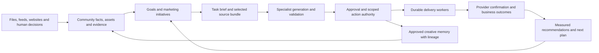

# oneClick: marketing platform and ingestion review

October 13, 2026. Companion to the [community brain architecture review](/Users/jasjitgill/oneClick/docs/COMMUNITY_BRAIN_ARCHITECTURE_REVIEW_2026_10_13.md). Based on the local working tree, including all 14 uncommitted application/test files, and read-only queries against the live oneClick Supabase project. Installed database definitions and actual records take precedence over migration files. Application deployment revision and provider credentials were not attested. Findings below distinguish implemented code, installed database behavior, and observed adoption.

Execution handoff: [technical implementation plan](/Users/jasjitgill/oneClick/docs/COMMUNITY_BRAIN_IMPLEMENTATION_PLAN_2026_10_13.md), including format qualification, shared context, internal portfolio assistance and channel-by-channel automation.

## The decision

**Keep the stack and evolve the product around a complete marketing operating cycle.** Each community needs a shared brain, but it also needs explicit goals, an inventory of what can be marketed, a plan, execution permissions, confirmed delivery, and trustworthy outcome measurement. A better vector database would address only a small part of that system.

The strongest existing foundations are typed property records, brand contracts, retained context, approvals, durable work records, exact asset handoff, publication receipts, and increasingly careful measurement semantics. Preserve them. The main architectural work is connecting these capabilities through common identities and contracts, then qualifying one complete workflow before expanding autonomous action.

My recommendation remains **one shared Supabase platform with logically isolated community knowledge**, rather than a physical vector database per community. Within that boundary, distinguish community facts, competitor observations, approved creative examples, private operational information, and measured results. Separate databases would not prevent confusing those categories inside one community.

**Mandatory refinement: zero unauthorized cross-community access, knowledge mixing, or writeback, including between communities in the same organization.** The recommendation for shared storage is conditional on database-enforced and end-to-end verified community boundaries. The live policies rechecked at 23:02 UTC still include organization-wide access, so the current platform is not certified to satisfy this requirement. Follow the [strict isolation and fidelity contract](/Users/jasjitgill/oneClick/docs/COMMUNITY_BRAIN_ARCHITECTURE_REVIEW_2026_10_13.md) before expanding automation. Where containment of a compromised privileged worker is required, use independently credentialed community data environments covering facts, vectors, assets and execution access; separating vectors alone does not provide that containment.

**An internal portfolio assistant is an explicit product requirement.** Authorized team members must be able to ask questions across selected communities, retrieve exact floorplan/image assets, compare campaign performance, and obtain collated insights. The assistant resolves the permitted community set, gathers community-labelled evidence through scoped services, and stores its answers in a separate internal workspace. Community KBs and generation sessions remain isolated. The detailed access, retrieval, provenance and conversation design is in the main review's “Internal portfolio assistant” section.

There should also be a distinction between:

- **A service package:** the goal, scope, deliverables, timing, allowed channels, budget, and approval rules for work such as a lease-up campaign.
- **A generation context bundle:** the exact facts, brand version, selected files, examples, and evidence that a particular task may use.

The responsible agent needs both. A website generator does not need every campaign metric or private lead note; a campaign planner does need a reliable performance summary and current availability. SiteForge already delivers a real source archive with media bytes and a source manifest. ForgeStudio has a retained context-bundle pattern. Generalize these handoffs across products; do not assume a RAG query or a service-package label delivers the necessary inputs automatically.

## What the broader code sweep changes

| Capability | What exists | What the live evidence does and does not establish |
| --- | --- | --- |
| Shared execution foundation | Jobs, action attempts, policy decisions, approvals, execution budgets, context snapshots, and outcome records | 1,974 jobs, 1,239 action attempts, 880 approvals, and 1,275 policy decisions demonstrate retained history. These counts are not evidence of successful marketing outcomes or current provider qualification. |
| Agency planning and coordination | Plans with goals, success measures, evidence, and bounded steps | The plan contract is `proposal_only`, with `executionAuthorized: false`. The live project has zero agency plan revisions and execution runs. |
| Agency execution | A carefully bounded rehearsal for `lead.note.add` and `market.alert.dismiss`, with saved scope and reversible changes | The installed function requires a database name matching `^phase7_execution_[0-9]{8}$`; the live database is `postgres`. This executor is disabled here. Removing the guard would not turn it into a marketing orchestrator. |
| Website generation and delivery | Source packages, dedicated deployment workflows, evidence records, and a SiteForge autonomy-promotion API | Reuse the product-specific delivery paths. New package job/release tables are empty in this project; this does not mean older website workflows are absent. SiteForge has real staged-autonomy code, with production launch excluded from automatic execution. |
| Social generation and publishing | ForgeStudio context, saved publication intent, provider acknowledgements, and reconciliation of uncertain results | New social connections, publications, ForgeStudio generation receipts, and measurements are empty. Local adapter registration includes Facebook, Instagram, and LinkedIn; TikTok/X are gated off by default. Registration does not prove a connected, qualified account. |
| Paid media | Google Ads and Meta reporting/discovery tools, account connections, and marketing facts | Inspected exposed Google Ads tools are read-only. Meta has some write helpers, but its corresponding upload/budget tool definitions are commented out. A qualified campaign creation, approval, launch, pacing, and optimization workflow is still required. |
| Lead response and nurturing | Luma chat, email/SMS workflow delivery, tours, and durable CRM handoffs | 65 leads, 182 conversations, 4 tours, 1 CRM handoff, and 2 CRM receipts exist. New workflow-delivery, tour-outcome, and delivery-outcome tables are empty. The 24,687 legacy workflow-action rows must not be interpreted as confirmed messages. |
| Reviews and reputation | Intake, analysis, response drafting, testimonial reuse, and publication evidence | Inspected review publication explicitly prepares and records manual publication; it is not a universal review-platform publishing connector. |
| Search visibility and market intelligence | GEO runs, competitive captures, Search Console ingestion, and source-linked market observations | 60 GEO runs and 52 market captures exist. Search Console is the enabled provider in the newer intelligence connector; CallRail and Buildium are explicitly deferred there. This is a foundation for monitoring, not evidence that every listing/search channel is managed. |
| Reporting and learning | Delivery states, BI/reporting contracts, experiment outcomes, and the user's uncommitted reporting improvements | New delivery work/reporting tables are empty. Eight shared experiment outcomes describe SiteForge sessions and conversion rates, four `neutral` and four `unknown`, dated August 13–17. They do not establish a current autonomous improvement loop or verified leases. |
| Multiple real estate business models | Vertical contracts cover residential, commercial, senior care, developments, portfolios, rental, sale, and different conversion intents | Nine vertical-profile versions exist, but the newer offering and conversion-intent version tables are empty. Adopt this model incrementally instead of making rental floorplans and leases universal assumptions. |

Code evidence: [agency plans](/Users/jasjitgill/oneClick/p11-platform/apps/web/utils/agency/plans.ts), [agency execution](/Users/jasjitgill/oneClick/p11-platform/apps/web/utils/agency/execution.ts), [shared dispatcher](/Users/jasjitgill/oneClick/p11-platform/apps/web/utils/services/shared-dispatcher.ts), [SiteForge autonomy](/Users/jasjitgill/oneClick/p11-platform/apps/web/utils/siteforge/autonomy-policy.ts), [social publication worker](/Users/jasjitgill/oneClick/p11-platform/apps/web/utils/forgestudio/publication-worker.ts), [Google Ads tools](/Users/jasjitgill/oneClick/p11-platform/services/mcp-servers/google_ads/server.py), [Meta tools](/Users/jasjitgill/oneClick/p11-platform/services/mcp-servers/meta_ads/server.py), [workflow delivery](/Users/jasjitgill/oneClick/p11-platform/apps/web/utils/services/workflow-delivery.ts), [CRM delivery](/Users/jasjitgill/oneClick/p11-platform/apps/web/utils/services/crm-sync.ts), [review publication](/Users/jasjitgill/oneClick/p11-platform/apps/web/utils/reviewflow/publication-contracts.ts), [intelligence providers](/Users/jasjitgill/oneClick/p11-platform/apps/web/utils/intelligence/providers.ts), and [vertical contracts](/Users/jasjitgill/oneClick/p11-platform/apps/web/utils/siteforge/verticals/contracts.ts).

The generic shared dispatcher currently registers social publication only. Other products have dedicated workers that own their domain transactions; this is not evidence that the platform can execute only social work. Standardize the action and receipt contract across these workers before considering a single dispatcher.

Similarly, ForgeStudio's standalone autonomy-policy helper has no production caller found in this sweep. SiteForge has a separate, wired autonomy-policy implementation. Treat these as different levels of adoption, rather than claiming either that autonomy is universally implemented or that it is entirely absent. The global outbound-delivery guard defaults to paused unless explicitly configured otherwise; the current deployment setting was not inspected.

## Ingestion: current support is partial

**The current pipelines do not yet cover all the formats and sources this product needs.** Support has to mean more than accepting a file: retain it, extract useful information, identify its subject, review the right claims, link it to the correct entity, and deliver it to the consuming product.

| Input | Current path and limits | Required completion |
| --- | --- | --- |
| Digital PDF, TXT, Markdown | Reviewed knowledge upload retains originals; PDF up to 10 MiB, UTF-8 text/Markdown up to 256 KiB. PDF worker extracts ordered text, with page evidence and bounded processing. | Reuse this lifecycle for document sources. Expose extraction limitations, source versions, and searchable publication state. |
| Scanned PDFs, scanned brochures, image-only documents | PDF text extraction explicitly has no OCR. Blank/image-only PDFs cannot produce useful text through this path; mixed PDFs can leave image content unexamined. | Page rendering, OCR and layout/visual extraction with page coordinates; proposed facts require review. Test scans, tables, columns, and mixed documents. |
| Community photographs | SiteForge accepts JPEG/PNG/WebP up to 20 MiB, retains assets, and runs visual analysis. Generic library also accepts GIF. | Unify intake and metadata across products. The generic library uploader itself does not run the SiteForge visual-analysis pipeline or populate embeddings. Add consistent captions, subject, role, renditions, and permitted use. |
| Floorplan drawings as images | The guided SiteForge flow uploads JPEG/PNG/WebP, stores an asset ID, and carries that link through the floorplan import. Packaging retains exact image bytes, but a conflicting legacy URL can incorrectly add a second drawing association. | Repair authoritative asset-ID precedence, then bring the binding into the newer reviewed unit-data experience. The dedicated manual floorplan console uses image URLs; the newer unit-data contract lacks the same image-asset field. |
| Floorplan drawings as PDFs | PDF is accepted by document storage/text extraction, but the inspected floorplan image upload accepts images only. | Retain the PDF, generate page previews, identify each plan, bind the reviewed drawing/page to a plan ID, and propose structured specifications. Never infer exact dimensions or architectural accuracy from visual similarity. |
| Logos, brand graphics, fonts | Brand asset upload accepts JPEG/PNG/WebP/SVG and WOFF2, up to 20 MiB. Brand text-source import accepts PDF/TXT/Markdown. | Preserve exact logo variants, font identities, and brand roles. Route brand documents through retained originals: the current brand-source route passes extracted text and a byte hash to its RPC, without uploading the original file. Add safe brand ZIP intake if required. |
| DOCX, PPTX, XLSX and cloud-native office files | The reviewed knowledge uploader does not accept these. A bucket allowing DOCX is not a parser. | Add document/slide extraction and provider export; route spreadsheets to typed tables or metric imports with units, currency, dates, and provenance. Do not turn every spreadsheet cell into a fact chunk. |
| CSV floorplans and metrics | Separate reviewed floorplan imports and intelligence CSV imports exist, with useful schema validation. | Reuse typed preview/review. Preserve source identifiers, distinguish snapshots from events, support corrections, and add XLSX only through the same validation. |
| Videos | Generic library accepts MP4/WebM up to 100 MiB in code, but writes to a live bucket that rejects those MIME types. | Fix the destination/limits contract first. Add metadata extraction, playback renditions, thumbnails/keyframes, transcript/captions, and time-coded evidence where relevant. MOV needs an explicit accepted conversion path. |
| Audio | The older content bucket permits some audio MIME types; no corresponding complete audio ingestion/transcription path was established in the inspected community intake flows. | Add MP3/WAV intake and reviewed transcripts when interviews, briefs, or recordings become a product input. Keep private communications out of public retrieval. |
| HEIC/HEIF, TIFF, AVIF and creative originals | These are not accepted by the inspected community photo routes. AI/EPS/PSD/CAD/BIM files do not have an established semantic ingestion path here. | Prioritize common phone/photo conversions. Retain specialized originals with a supplied/exported preview and truthful capability status; defer native CAD/BIM interpretation until needed. |
| Drive/Dropbox folders | Asset-source adapters discover JPEG/PNG/WebP images and feed an ingestion pipeline. Live source/run tables are empty. | Qualify credentials and sync behavior on a pilot. Extend explicitly for documents/video; provider connection alone does not imply those formats are supported. Retain provider ID, revision, move/deletion, and reconnect state. |
| Community and competitor websites | Static HTML knowledge capture and separate browser-backed crawler code exist. Recent market captures are retained. | Choose static/rendered capture by source, discover relevant linked documents/media deliberately, preserve captures, and keep competitor evidence separate from community facts. Repair the recurring-check eligibility described in the main review. |
| Inventory, CRM, ad, analytics and review feeds | Multiple product-specific connectors and imports exist at different maturity levels. | Use typed adapters and stable external IDs with freshness, completeness, pagination, reconciliation, and per-account scopes. These observations primarily belong in structured tables. |
| Virtual tours and external media | A tour/embed URL is a different input from an owned downloadable video or model. | Retain approved provider links/embed references and linked offering IDs; do not promise file ingestion or reuse that a provider does not support. |

Evidence: [knowledge uploads](/Users/jasjitgill/oneClick/p11-platform/apps/web/utils/knowledge/file-store.ts), [PDF extraction](/Users/jasjitgill/oneClick/p11-platform/apps/web/utils/knowledge/file-extraction.ts), [generic media upload](/Users/jasjitgill/oneClick/p11-platform/apps/web/utils/forgestudio/asset-library-store.ts), [SiteForge upload](/Users/jasjitgill/oneClick/p11-platform/apps/web/app/api/siteforge/assets/route.ts), [visual analysis](/Users/jasjitgill/oneClick/p11-platform/apps/web/utils/siteforge/assets/image-analysis.ts), [guided floorplan UI](/Users/jasjitgill/oneClick/p11-platform/apps/web/components/siteforge/PropertyAssetsStep.tsx), [unit-data contract](/Users/jasjitgill/oneClick/p11-platform/apps/web/utils/property-units/contracts.ts), [floorplan adapters](/Users/jasjitgill/oneClick/p11-platform/apps/web/utils/siteforge/providers/floor-plans.ts), [brand assets](/Users/jasjitgill/oneClick/p11-platform/apps/web/app/api/brandforge/content-assets/route.ts), [brand-source import](/Users/jasjitgill/oneClick/p11-platform/apps/web/app/api/brandforge/import/sources/route.ts), [cloud-source adapters](/Users/jasjitgill/oneClick/p11-platform/apps/web/utils/siteforge/assets/source-adapters.ts), and [source ingestion](/Users/jasjitgill/oneClick/p11-platform/apps/web/utils/siteforge/assets/source-ingestion.ts).

### Confirmed compatibility and handoff gaps

1. **Video destination mismatch.** `uploadLibraryAsset` always uses `property-assets`. The live bucket permits common images, SVG, PDF and WOFF2, with a 50 MiB cap; it permits neither MP4 nor WebM. The separate `content-assets` bucket allows video and 100 MiB, but this uploader does not use it. Choose a canonical destination and keep the UI, upload validator, recovery path, bucket policy, and downstream readers consistent. Test against actual staging storage.
2. **Upload limits exceed generation-package limits.** The SiteForge package assembler includes approved library assets and limits every file to 5,000,000 bytes and combined media to 35,000,000 bytes. A valid 12 MiB uploaded photo can therefore block generation. Introduce selected task assets and suitable renditions, each linked to its original/hash; fetch additional approved files when needed. Do not solve this by sending every original to every agent.
3. **Floorplan binding is uneven.** Of 40 live unit records, seven have an image URL and one has an image asset ID. Four library assets have the floorplan role. The installed `apply_property_unit_import` validates that an asset link belongs to the property and is an image with the floorplan role. Reuse it, while converging this older import path with the newer fact-review lifecycle. Preserve correct explicit links; do not guess the missing ones from filenames alone.
4. **Storage and publication approval are separate.** The relevant property/brand/content buckets are public. A pending asset row does not make its object private. Prefer private originals and deliberate public delivery renditions, with a compatibility plan for existing website URLs.
5. **Transport limits need deployment verification.** Current routes generally receive the bytes through the app server. If these handlers run as Vercel Functions, the documented 4.5 MB request/response payload limit is below several application limits. Use scoped direct uploads for larger assets, then verify the saved object and process asynchronously. Supabase recommends resumable TUS uploads above 6 MB. This is a conditional deployment constraint, not proof that a particular current deployment is failing. [Vercel limits](https://vercel.com/docs/functions/limitations), [Supabase resumable uploads](https://supabase.com/docs/guides/storage/uploads/resumable-uploads).
6. **Explicit floorplan IDs can compete with legacy URLs.** Executing the actual [source assembler](/Users/jasjitgill/oneClick/p11-platform/apps/web/utils/siteforge/packages/source.ts:62) with two approved drawings reproduced a manifest that associates both with one plan: one matches its explicit asset ID, the other its old URL. The ID must win everywhere; URL fallback belongs only to plans without an ID, and ambiguous fallback must fail. The 23:14 UTC live check found no existing eligible conflicting combination. This is a verified code defect, not a finding that a live site currently shows the wrong drawing.

The final ownership check found no mismatch in the one saved floorplan asset link, 81 existing website-to-library asset links, or 1,659 job-to-context links examined. Preserve the valid links. Add database ownership invariants across writers: some current relationships have ID-only foreign keys, and website source-asset links have none, although selected import functions and domain triggers already enforce narrower checks.

There are currently zero rows in the newer `knowledge_files`, extraction, material, brand-import-source, cloud-asset-source, and cloud-ingest-run tables, alongside 26 floorplan imports. These new pipelines need adoption and live qualification as well as feature completion.

### One intake contract, several processors

Use a common ingestion record and job lifecycle, with specialized document, image, floorplan, structured-data, video, and web processors. A single universal parser would lose useful distinctions. Supabase Storage should retain original bytes; Postgres should retain metadata, relationships and reviewed facts; derived text or visual representations can enter compatible search indexes.

Each ingestion records tenant/community, described entity, source identity/revision, checksum, actual file type, extraction recipe, publication eligibility, and dependencies. Suggested lifecycle:

```text
received → original verified → processing → needs review → approved → ready for selected uses
                                ↘ failed / partially extracted / unsupported
```

Show separate progress for storage, extraction, review, entity linking, and availability to generators. An accepted floorplan should not be described as ready for website generation while its drawing is unlinked or its media exceeds the package limit.

Use immutable originals, recoverable upload intents, bounded asynchronous jobs, retry deduplication, resource limits, and per-community queues/quotas. Preserve source identity even when identical bytes are reused: two identical brochures do not provide two independent confirmations. Replacements retire a version and invalidate its dependent artifacts; failed reprocessing keeps the last eligible version available unless explicitly withdrawn.

For OCR/layout tooling, evaluate a small representative set before choosing a vendor. A managed document service is an option, but format support is processor-specific; for example, Google Document AI lists office formats only for its Layout Parser. Compare extraction quality, page evidence, latency, retention requirements, and cost on actual floorplans and brochures. Do not expect text OCR alone to recover correct room geometry. [Document AI format support](https://docs.cloud.google.com/document-ai/docs/file-types).

## The operating model for eventual automation



### Make the marketing initiative the common unit of work

A community brain answers what is known. An initiative answers what the business is trying to accomplish and how success will be checked. Add or standardize that shared identity across existing delivery work, agency plans, content briefs, campaigns and reports, rather than creating another disconnected product workspace.

An initiative needs: community and offering IDs; lifecycle stage; objective and baseline; valid time window; approved offer and brand versions; selected channels; deliverables and responsible parties; separate production/AI and media budgets; dependencies; action permissions; measurement definitions; and stop/review criteria. Keep all provider campaign, creative, landing page, form, and CRM outcome identities attached to it.

For example, an effort to improve qualified tours for available two-bedroom plans should combine verified availability, exact plan images, suitable landing-page content, a chat answer/update, selected social or ad variants, and tracked inquiry-to-tour outcomes. If inquiries are already strong but tour response is poor, the next recommendation may be lead follow-up or form repair. Generating more content should be a decision supported by evidence, not the default response to every underperforming metric.

Reuse the existing vertical model. A rental community, home development, commercial property, and senior-care community have different offerings, conversion intents, and source policies. Start with one business model for the pilot while keeping those distinctions in shared contracts.

### Let agents propose and create; give durable workers explicit actions

Use specialist generators and planners sharing community context. The coordinator selects a bounded next task, obtains the relevant evidence, and proposes work. A separate execution boundary checks the current community/account binding, exact approved artifact, input revision, allowed operation, limits and expiry before doing anything externally visible.

Keep four decisions distinct: whether a fact is accepted, whether creative is approved, whether an external action is authorized, and whether spending is allowed. Approved copy does not imply authority to launch an ad campaign. A model token budget does not cap media spend. The existing `shared_execution_budgets` machinery addresses processing resources; media spend needs its own currency, period, pacing, daily/cumulative caps and recorded authorization. Likewise, permission to compare several communities or download their assets through the internal assistant does not authorize publication, spending, or asset reuse for another community.

Preserve the existing pattern of saved intent, exact input hash, provider receipt, and reconciliation after uncertainty. A retry should not blindly duplicate a post, SMS, CRM record, or ad. Keep cancellation and compensation semantics action-specific: restoring a web revision differs from pausing an ad, and a delivered message cannot be unsent by a database rollback.

Use deterministic workflows for repeatable onboarding, ingestion, approvals, publication, and measurement. Use agent discretion for synthesis, strategy, creative exploration, and bounded tool selection. This matches the distinction between predefined workflows and agent-directed execution described in [Anthropic's agent design guidance](https://www.anthropic.com/engineering/building-effective-agents); a new all-purpose agent framework is not required before the existing contracts can be connected.

### Make measurement a prerequisite for optimization

The uncommitted reporting work is valuable and should be retained: it distinguishes missing values from zero, groups source/account data, handles observation semantics, and preserves uncertain lease attribution. It is not yet applied everywhere. The older [campaign analytics endpoint](/Users/jasjitgill/oneClick/p11-platform/apps/web/app/api/analytics/campaigns/route.ts:72) still normalizes missing measures to zero and aggregates spend without currency handling. Share one metric definition/validation layer across reports and decision tools.

Retain separate records for provider acceptance, actual publication/delivery, engagement, qualified inquiry, appointment/tour, application, lease/contract, and move-in where available. A saved `released` state or a successful connector request does not establish the next stage. Preserve timezone, attribution model, reporting window, currency, data completeness, late updates, deduplication, and the distinction between inquiry cohorts and period totals.

The 43 live marketing fact rows still end on December 19, 2025 and lack currency. Resolve feed freshness and semantics before recommending autonomous spend allocation. In the newer intelligence provider path, bindings currently come from an environment JSON list capped at 200 entries. Move scalable per-community/account connection management into the existing integration/credential patterns; simply increasing that parser limit is not sufficient account lifecycle management.

The final check reproduced misleading success in the [legacy pipeline runner](/Users/jasjitgill/oneClick/p11-platform/services/data-engine/run_pipelines.py): a normally returning inner function becomes `success` with zero records, even when that function stopped after an error. Its Google account lookup also returns an empty list on database failure, enabling an environment-based fallback. Deployment of that runner was not attested. The newer [tracked importer](/Users/jasjitgill/oneClick/p11-platform/services/data-engine/pipelines/mcp_marketing_sync.py) already scopes accounts and confirms stored counts; reuse and qualify that path. Track completeness per account/window and distinguish failure, partial delivery and valid empty data. The existing live deduplication key is already account-aware, and the current report builder deliberately withholds unconfirmed/non-USD spend; retain both protections.

Use descriptive results when causal evidence is unavailable. Save a hypothesis, changed artifact/version, comparison window or experiment design, observed outcome and limitations. Creative approval is feedback about usability and taste, not proof that the content caused leases. Keep private creative examples and learned preferences inside their community. Authorized portfolio comparisons and asset retrieval use the separate internal assistant capability; their combined context and raw evidence must not be fed back into individual community KBs or generation sessions.

### Let approved work update the correct memory

An approved logo updates the exact brand asset; confirmed floorplan specifications update reviewed structured facts; approved copy becomes a reusable creative example; an ad receipt updates execution history; performance measurements update the observation ledger. Every derived item retains its original sources.

Capture editorial preferences and rejection reasons as scoped guidance when appropriate. Repeated approval of one draft must not silently grant permission for new spending or external actions. Never increase factual confidence because several generated outputs repeat the same original claim.

Refresh incrementally on source changes and approval events. Coalesce related changes, avoid cycles, and use dependency tracking to identify stale drafts and published pages. Routine observation should update last-checked time without creating endless new fact versions or repeatedly asking for approval of unchanged content.

## Implementation order and completion gates

| Priority | Work | Demonstration required before expanding |
| --- | --- | --- |
| 0. Enforce community isolation | Bind every request/job to one authorized community; reconcile organization-wide policies; constrain privileged paths; enforce ownership across sources, assets, caches, agent state, integrations and writeback. | Direct-database and end-to-end allow/deny tests for two same-organization communities and a different organization. Missing scope fails closed; wrong-owner assets, cache results and late callbacks cannot cross the boundary. Any failure blocks the affected path. |
| Internal assistant after gate 0 | Add an explicit portfolio parent scope with community-bound reads, exact asset retrieval, selected-community campaign comparisons and cited synthesis. Reuse the local portfolio/reporting services. Restrict external tool access and scope provider state. | A permitted employee retrieves A/B floorplans and compares X/Y/Z campaigns with source labels and coverage; unauthorized communities never enter model context. Subsequent authenticated history/download requests enforce revocation, with outstanding-link and in-flight limits tested and disclosed. Combined answers do not write into community KBs. |
| 1. Repair input and serving contracts | Resolve video bucket/limit mismatch and explicit-ID/legacy-URL conflicts; converge floorplan asset links with reviewed unit facts; retain brand originals; add PDF page/OCR intake; prevent competitor/internal evidence becoming public claims. | One community uploads photos, a logo, a text brochure, a scanned brochure and a PDF/image floorplan. The same reviewed facts and exact assets are available to site, chat and social generation. Rendered critical claims and drawing mappings are verified. Unsupported files fail clearly. |
| 2. Deliver a complete managed campaign | Add the shared initiative/task brief; connect existing planners, context bundles, approvals and one qualified channel worker. Repair stale measurement feeds and common metric semantics in parallel. | An operator can inspect the goal, all source versions, approved creative, confirmed destination, and measured inquiry/tour outcome in one chain. Show missing outcomes honestly. |
| 3. Complete source and outcome maintenance | Recurring source checks, revision/deletion handling, lineage invalidation, feed reconciliation, queue fairness, and visible exception handling. | Replace a logo, expire an offer, revoke a source, and replay interrupted jobs without wrong assets, stale public claims, lost work, or duplicate provider actions. |
| 4. Expand channels and bounded autonomy | Qualify ad mutations, reviews/listings and other channel capabilities separately. Extend action policies with account, spend, frequency, expiry, pause and recovery controls. | Repeated supervised delivery and recovery evidence for each action type; measured quality and business outcomes where that action can affect them. Never promote all actions merely because one channel passed. |
| 5. Scale and optimize | Replay representative workload for hundreds of communities; measure retrieval, OCR/media processing, provider quotas, database contention, delivery costs and operator review capacity. | Demonstrate agreed freshness/latency/cost targets and fair service under uneven tenant load, then tune indexes, queues or specialized infrastructure where measurements justify it. |

Do not postpone foundational OCR or floorplan ingestion until a later visual-similarity project. They are basic onboarding requirements. Multimodal similarity search is a later enhancement once exact asset identity, metadata search and generation handoff work reliably.

The first release should make one complete community workflow dependable. That proves more about readiness for an automated real estate marketing platform than increasing the number of isolated agents, upload endpoints, or vector collections.

The final research also tightened the isolation plan in the main review: start with exact scoped search, evaluate independent community indexes only when approximate retrieval is needed, use authenticated private downloads where revocation matters, and inventory model-provider files/responses/containers as scoped retained data. Signed URLs and their cached responses do not provide immediate membership revocation. Stored provider responses are not equivalent to transient inference. These are lifecycle requirements across the platform; a separate vector database alone would not address them. See the main review's “Image and file storage,” “Scaling to hundreds of communities,” and “Model-provider state” sections for the primary references and concrete design.

## Verification and limits

This sweep passed **114 existing tests across 13 files**, covering retained-file handling, real local PDF parsing, media upload validation/recovery, SiteForge and BrandForge upload routes, floorplan adapters, exact source packaging, cloud-source adapters/ingestion, unit contracts, agency planning/execution contracts, and social publication handling. The earlier reporting recheck passed **23 tests across three additional files**.

The final sanity check passed **114 tests across nine files** covering shared access helpers, chat/editor scope, marketing-fact reads/reporting, package source assembly, archive validation, website quality and provider-runner recovery. This run overlaps the earlier source-package tests; it is not 114 additional unique tests. Separate isolated reproductions exposed the legacy-URL floorplan association and legacy pipeline success/lookup behaviors described above. No permanent application tests or implementation files were added during the audit.

Provider/storage operations in these suites are mocked; they do not validate live bucket compatibility, credentials, paid generation, or external delivery. This is why passing tests coexist with the confirmed bucket mismatch. No application code, database state, provider account, or deployment was changed. A complete end-to-end ingestion/delivery qualification remains implementation work. Aggregate query results, function-definition hashes, source queries, and the uncommitted-file fingerprints are retained in the [audit evidence](/Users/jasjitgill/oneClick/docs/COMMUNITY_BRAIN_AUDIT_EVIDENCE_2026_10_13.json); that JSON file is local and ignored by the repository's existing `*.json` rule.
